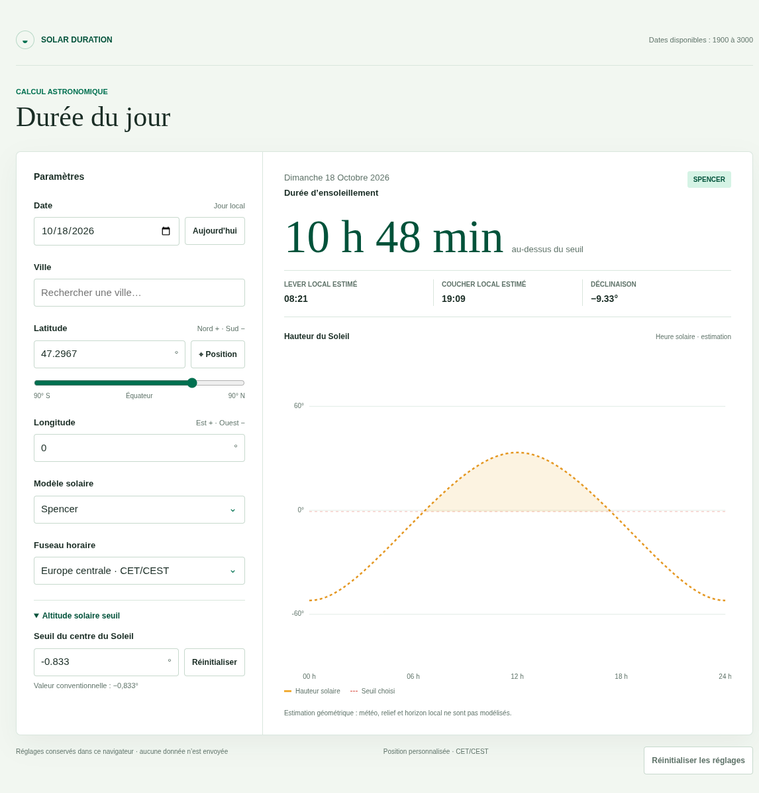

# Solar Duration

Solar Duration est une application web réalisée en JavaScript natif, sans framework ni dépendance. Elle estime, pour une date et un lieu, la durée pendant laquelle le Soleil reste au-dessus d'une hauteur choisie, ainsi que ses heures estimées de lever et de coucher.



## Ouvrir l'application

La [démo en ligne](https://domiq44.github.io/solar_duration_js/) est accessible sans installation.

Pour lancer l'application sur Linux, ouvrez un terminal dans le dossier du projet et exécutez :

```bash
./open-app.sh
```

Le script ouvre l'application dans votre navigateur. Python 3 est nécessaire pour ce lancement local.

## Utiliser l'application

1. Choisissez une date. Le bouton « Aujourd'hui » sélectionne le jour courant dans le fuseau horaire du lieu choisi, et non celui de l'appareil.
2. Choisissez une ville ou indiquez ses coordonnées. Le bouton « Position » peut remplir les coordonnées à partir de votre emplacement, avec l'autorisation de votre navigateur.
3. Vérifiez le fuseau horaire, puis choisissez un modèle de calcul si nécessaire. Le modèle recommandé est sélectionné par défaut.
4. Consultez la durée estimée, les heures locales de lever et de coucher, et le graphique. Une verticale fine repère le maximum de la courbe à midi solaire, avec « S » juste sous la ligne horizontale 0°. Lorsque la date affichée correspond au jour courant dans le fuseau du lieu, le soleil et une verticale marquent l'heure solaire actuelle; le repère est actualisé chaque minute. Vous pouvez modifier le seuil solaire pour adapter le calcul.

Le seuil par défaut est −0,833°. Il sert à estimer les heures habituelles de lever et de coucher. Aux endroits où le Soleil ne franchit pas ce seuil pendant une journée, l'application indique une nuit ou un jour polaire.

Le bouton « Réinitialiser les réglages » restaure les paramètres par défaut.

## À savoir

Les résultats sont des estimations, pas des horaires garantis. Le relief, les bâtiments, la météo et les conditions locales peuvent modifier les heures observées.

Les réglages sont conservés dans votre navigateur. Les paramètres de calcul ne sont pas envoyés à un service distant. La géolocalisation nécessite l'autorisation de votre navigateur.

## Vérification des calculs

Le modèle Meeus a été comparé à [Astronomy Engine](https://github.com/cosinekitty/astronomy) 2.1.19 pour six dates de 2024 : Paris aux solstices, Quito à l'équinoxe de mars, Tokyo en juin, New York le jour du passage à l'heure d'été et Sydney en décembre. Les deux calculs utilisent le seuil du centre solaire de −0,833°; les horaires de référence sont arrondis à la minute.

Sur ces cas, l'écart mesuré est inférieur à 30 secondes pour chaque lever et coucher, et inférieur à 26 secondes pour la durée du jour. Ces vérifications ne couvrent pas toutes les dates de 1900 à 3000 ni les modèles Spencer et sinusoïdal. Elles ne modélisent pas non plus l'horizon local ou les conditions atmosphériques.

## Développer

Le projet est une application web statique : il n'y a ni compilation ni dépendance npm à installer. Pour la lancer localement sous Linux, utilisez `./open-app.sh` comme indiqué plus haut. Ce script nécessite Python 3.

Installez [Node.js](https://nodejs.org/), puis lancez les commandes souhaitées à la racine du projet :

```bash
npm test
npm run test:coverage
```

`npm test` exécute les tests. `npm run test:coverage` exécute les mêmes tests et affiche leur couverture dans le terminal.

Les principaux fichiers sont regroupés dans `src/` : `main.js` relie l'interface aux calculs, `solar.js` et `calculation.js` gèrent les calculs, `cities.js` et `city-picker.js` gèrent les villes, et `chart.js` dessine le graphique. Les tests automatisés sont dans `tests/`.

Chaque mise à jour de la branche `main` déclenche automatiquement la publication sur [GitHub Pages](https://domiq44.github.io/solar_duration_js/).
